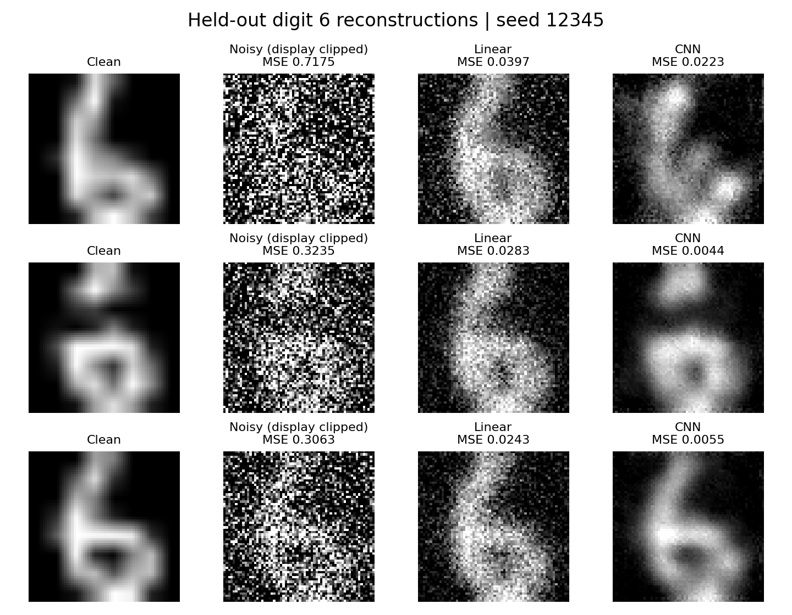
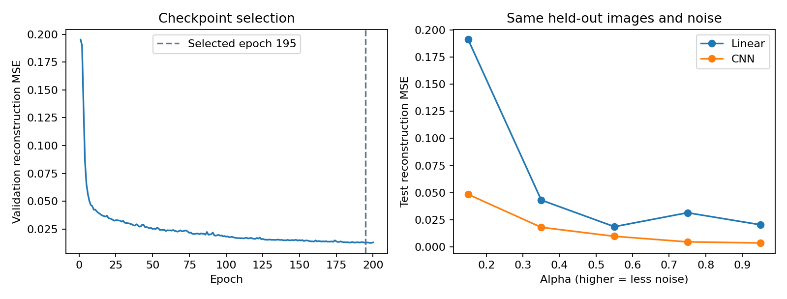

# Diffusion Six — 64×64 去噪实验

将手写数字 **6** 加上高斯噪声，用线性回归和 CNN 预测噪声，再重建图像。包含训练权重、Streamlit 应用、pytest、Docker、GitHub Actions 和 8 页英文报告。

**本项目按最新要求使用 64×64。** 课程图片原文要求 8×8；这里将 sklearn 自带的原始 8×8 数字图像先用双线性插值放大到 64×64，然后生成独立的 64×64 噪声、训练和推理。下载结果也是原生 64×64。插值不会增加原始图像的信息量，结果不能视为真实高分辨率手写数据上的评估。

## 在当前电脑启动

当前文件夹已有配置好的 Python 3.10 虚拟环境和训练完成的 `model.pt`，在 PowerShell 中运行：

```powershell
.\.venv\Scripts\python.exe -m streamlit run app.py
```

然后打开 <http://localhost:8501>。也可以运行 `start.ps1`。

界面流程：在 **Validation model** 选择数字 6 主实验或 NIST 数字 0–9 → 选择内置样例或上传数字 → 调整 α 和种子 → 点击 **Reconstruct image** → 查看重建图和 MSE → 下载 PNG 或实验 JSON。白底黑字图片请勾选 **Dark digit on a light background**。建议紧密裁剪数字，网页会保持比例缩放并补边到 64×64。上传文件不写入服务器磁盘。

## 在其他电脑安装

需要 **Python 3.10**；本机系统默认 `python` 是 3.7，请使用上面的虚拟环境解释器。新电脑先用自己的 Python 3.10 路径创建环境：

```bash
git clone <your-repository-url>
cd <repository-directory>
python3.10 -m venv .venv
# Linux / macOS
source .venv/bin/activate
# Windows PowerShell 改用： .\.venv\Scripts\Activate.ps1
python -m pip install -r requirements-dev.txt
python -m streamlit run app.py
```

`requirements.txt` 固定直接依赖版本，配置 CPU PyTorch 下载源；部署推理不需要 GPU。仅运行应用可安装 `requirements.txt`。模型和样例随仓库提交，启动时不重新训练，也不下载数据。当前机器的 `.venv` 继承已有 Anaconda 环境，其他电脑建议按上述命令创建独立环境。

## 训练和复现

课程数字 6 实验使用 `--digit-six`。下面的命令把结果放到新的实验目录。

```bash
python train.py --digit-six --seed 42 --epochs 60 --samples-per-epoch 512 --output-dir experiments/run-42
```

数字 6 模式默认使用 CPU，可用 NVIDIA GPU 时加上 `--device cuda`。训练固定 Python、NumPy、PyTorch 种子，使用确定性算法，保存数据划分、参数、版本和权重哈希。CPU/GPU、库版本或硬件变化仍可能产生数值差异；不承诺跨平台逐位相同。重新训练根目录权重后，请重新运行验证和报告生成；运行中的应用需要重启以清空模型缓存。

数据包含 181 个不同的数字 6：**115 训练 / 29 验证 / 37 测试**，在生成任何噪声前划分。验证集选择最佳 epoch；测试集不参与训练或选择 checkpoint。每个测试图片使用 8 个固定噪声样本，共 296 个测试观测；另报告 5 个固定 α 的表现。

```bash
python scripts/evaluate.py --verify
python scripts/observe.py
python scripts/build_report.py
```

`evaluate.py --verify` 重新计算指标，并检查模型、基线文件 SHA256 和数据划分。`observe.py` 记录 3 个样例 × 3 个 α × 3 个种子的重建质量和延迟。`build_report.py` 从真实结果和测试证据生成报告，不会伪造 GitHub Actions 或公网部署成功状态。

## 用 NIST SD19 训练数字 0–9

从 [NIST 官方页面](https://www.nist.gov/srd/nist-special-database-19) 下载 `by_class.zip`。把解压后的 `by_class` 放到项目根目录，保留 `30`–`39` 及其 `hsf_*` 子目录。

在编辑器里打开 `train.py`，选择项目的 `.venv` 解释器后直接运行。文件顶部的 `EPOCHS` 管轮数，`DATA_DIR` 管数据位置，`OUTPUT_DIR` 管保存位置。默认跑 60 轮，输出到 `experiments/nist-60epochs`。每个数字抽取 200 张训练图、15 张验证图和 15 张测试图。程序优先使用 CUDA，没有可用 CUDA 时用 CPU。再次训练时，把 `OUTPUT_DIR` 改为一个新目录。

原图为 128×128。加载时转为黑底白字、裁出笔画、等比例缩小并居中补边到 64×64，再生成高斯噪声。训练使用 `hsf_0/1/2/3/6`，验证使用 `hsf_7`，测试使用 NIST 指定的 `hsf_4`。`train_30`–`train_39` 是其他分区的汇总，训练时跳过这些目录。见 [NIST 用户指南](https://s3.amazonaws.com/nist-srd/SD19/sd19_users_guide_edition_2.pdf)。

输出目录里的 `results/metrics.json` 提供总体 MSE、按噪声强度和按数字的 MSE，`results/comparison.png` 展示三个测试数字的重建。报告和 `scripts/evaluate.py --verify` 仍使用原来的数字 6 主实验。

网页左侧 **Validation model** 可切换到 **NIST digits 0–9**。选择内置的 **Held-out digit** 或上传自己的干净数字，再调整 α 和随机种子，点击 **Reconstruct image**。**Held-out evaluation** 展示 NIST 独立测试集每个数字和各噪声强度的平均 MSE。网页使用的 NIST 权重、基线、十张样图和指标保存在 `models/nist/`，部署时不需要原始 `by_class/` 数据。

## 模型和实测结果

加噪：`z = sqrt(α) x + sqrt(1−α) ε`，其中 `ε ~ N(0, I)`。模型预测 ε，用 `x_hat = (z − sqrt(1−α) ε_hat) / sqrt(α)` 重建，最后裁剪到 `[0,1]`。加噪值不会在推理前裁剪，界面仅对预览作裁剪。MSE 以预处理后的干净参考图计算。

线性基线在每个像素独立拟合 `ε_j = w_j z_j + v_j α + b_j`，用轻微 L2 正则化稳定最小二乘解，不使用邻域或非线性特征。它不是拥有 4096×4096 系数的全连接回归。CNN 输入为带噪图和 α 通道，四层卷积的通道为 `2→16→16→16→1`、膨胀率为 `1,2,4,1`，感受野为 17×17。CNN 以噪声预测 MSE 训练，验证时用重建 MSE 选取 checkpoint。

| 测试指标 | 结果 |
| --- | ---: |
| 线性基线重建 MSE | 0.046294 |
| CNN 重建 MSE | 0.024335 |
| CNN 平均 MSE 降幅 | 47.43% |
| 最佳 epoch | 59 / 60 |

完整指标见 [`results/metrics.json`](results/metrics.json)。CNN 并非在每种条件下都更好：α=0.55 时线性基线为 0.01856，CNN 为 0.01872，CNN 略差。低 α 时两种模型都更困难。当前实验只有一个数据划分和训练种子，不代表统计显著性。





## 自动化测试

```bash
python -m pytest -q --junitxml=results/tests.xml
```

覆盖 64×64 形状、已知真实噪声的精确反演、种子复现、α 边界、非法图像、上传预处理和透明背景、PNG 下载尺寸、数据无泄漏、旧 8×8 权重拒绝、已保存模型有限输出，以及 Streamlit 示例重建和上传等待流程。Streamlit AppTest 验证应用逻辑，不代替真实浏览器端到端测试。

## Docker 构建和运行

```bash
docker build -t diffusion-six .
docker run --rm -p 8501:8501 --name diffusion-six diffusion-six
```

打开 <http://localhost:8501>，在另一终端验证：

```bash
docker inspect --format='{{.State.Health.Status}}' diffusion-six
docker logs diffusion-six
```

容器使用 Python 3.10、CPU 推理、非 root 用户及 `/_stcore/health` 健康检查。停止前台容器按 Ctrl+C；后台启动可加 `-d`。Docker 构建需要下载基础镜像与依赖。

## GitHub 和自动检查

当前目录已初始化本地 Git 仓库。将真实 GitHub 地址填入下方命令后提交、推送：

```bash
git add .
git commit -m "Build 64x64 digit six denoising application"
git remote add origin https://github.com/<owner>/<repo>.git
git push -u origin main
```

`.github/workflows/test.yml` 在 push、pull request 和手动触发时运行两个 job：安装依赖 → pytest → 验证已保存模型的评估；以及 Docker 构建 → 容器启动 → HTTP 健康检查。测试 XML 作为 Actions artifact 上传。推送后在 GitHub **Actions** 页面查看并保存成功截图，作为课程要求的真实自动化证据。当前没有配置 GitHub 远程仓库，不能把本地测试通过写成 GitHub Actions 已通过。

## 部署与观察

可按 [Streamlit Community Cloud 官方部署文档](https://docs.streamlit.io/deploy/streamlit-community-cloud/deploy-your-app/deploy) 连接上述 GitHub 仓库，选择实际分支和入口 `app.py`。确保提交 `app.py`、`diffusion_six/`、`model.pt`、`baseline.npz`、`examples/`、`models/nist/`、`results/metrics.json` 和 `requirements.txt`。也可以在服务器运行上述 Docker 镜像，配置 HTTPS 和外部访问。

本地容器地址是本机访问入口。**公网发布及 GitHub Actions 成功截图需在绑定实际账号/仓库后完成**。请在 [`reports/submission-checklist.md`](reports/submission-checklist.md) 填入公开 URL、仓库 URL、成员信息及真实截图。

部署后检查不同 α、种子、手写样式、无效文件、空白图片；查看日志中的推理耗时及异常。`results/observations.json` 给出本地 27 个输入组合的质量变化，不能替代公网可靠性监测。下一步优先使用真实 64×64 手写数据、多个训练种子、针对低 α 的训练，并增加真实上传的浏览器测试。

## 目录与提交材料

课程要求见 [DTD 项目大纲](docs/course/DTD_2026-ProjectDetails.pdf)。手动验证上传流程可用 [数字 6](examples/manual/6.png)。NIST 数据及独立实验输出保存在本地，Git 和 Docker 构建上下文默认忽略这些目录。

```text
app.py                       Streamlit 界面
train.py                     可复现训练和评估
model.pt                     64×64 CNN 权重与元数据
baseline.npz                 每像素线性基线参数
diffusion_six/               图像/噪声处理、数据、模型
examples/                    网页内置的 3 个测试集数字 6
models/nist/                 网页 0–9 模式的权重、样例和评估结果
examples/manual/             手动上传用的图片
by_class/                    解压后的 NIST 训练数据
docs/course/                 课程项目要求与参考资料
experiments/                 独立训练的权重、指标与结果图
tests/                       数值与应用测试
scripts/                     评估、观察、报告生成
results/                     真实指标、曲线、重建图、测试证据
reports/report.pdf           8 页英文项目报告
reports/report.md            可编辑报告正文
reports/submission-checklist.md
requirements*.txt
Dockerfile
.github/workflows/test.yml
```

这是受扩散原理启发的单步去噪演示。应用从上传的干净参考图生成高斯噪声，再测量重建误差。两种模型的训练范围都是 `α∈[0.15,0.95]`。

参考：[PyTorch 权重加载](https://docs.pytorch.org/docs/stable/notes/serialization)、[Streamlit 应用测试](https://docs.streamlit.io/develop/concepts/app-testing)、[Streamlit Docker 部署](https://docs.streamlit.io/deploy/tutorials/docker)。
